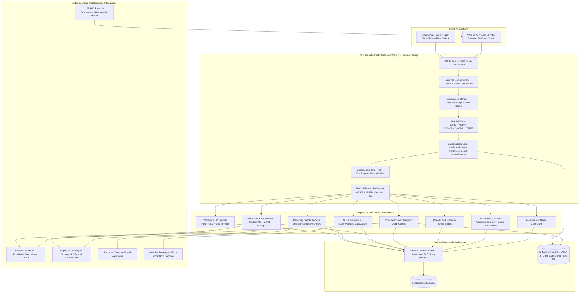
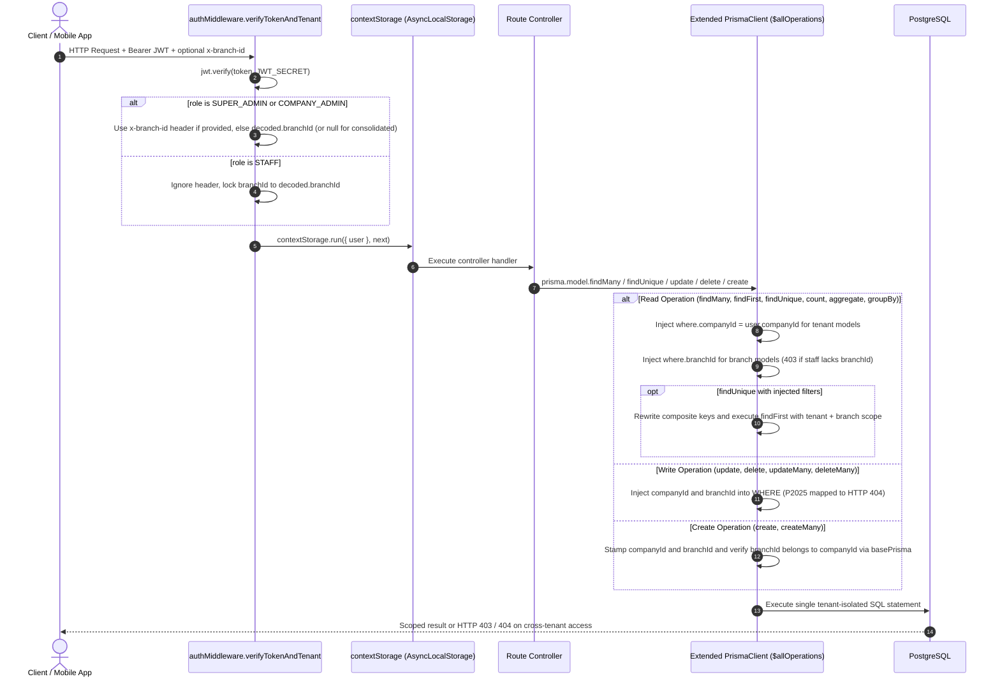
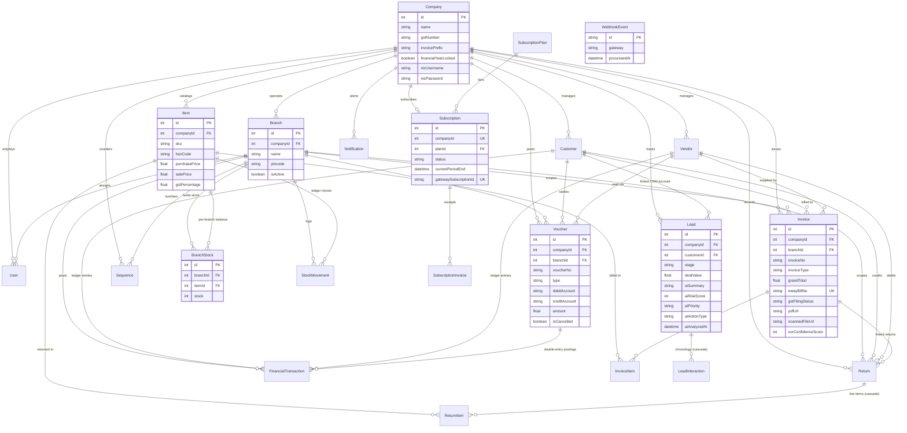
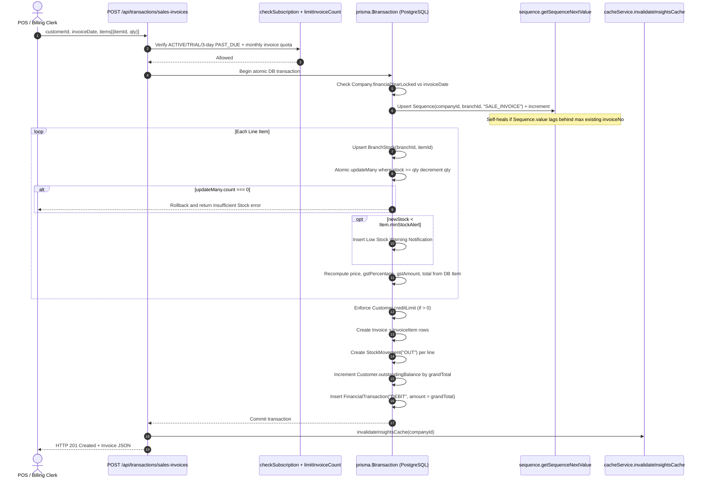
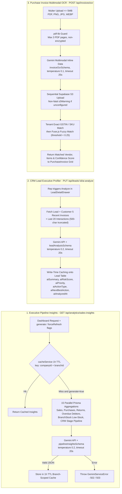
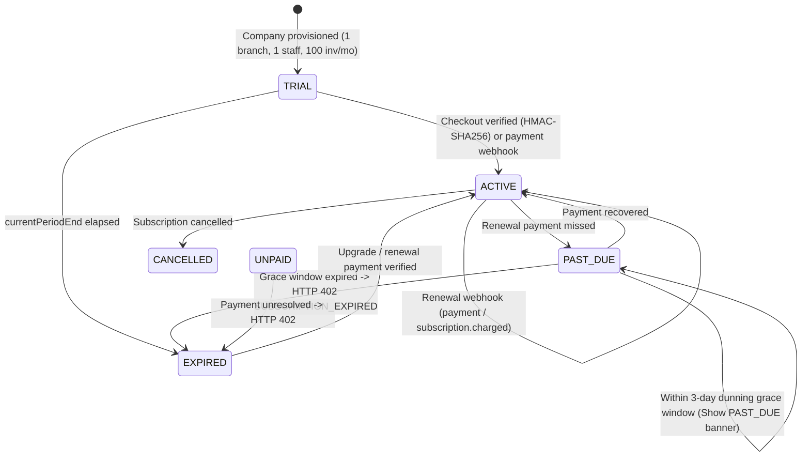
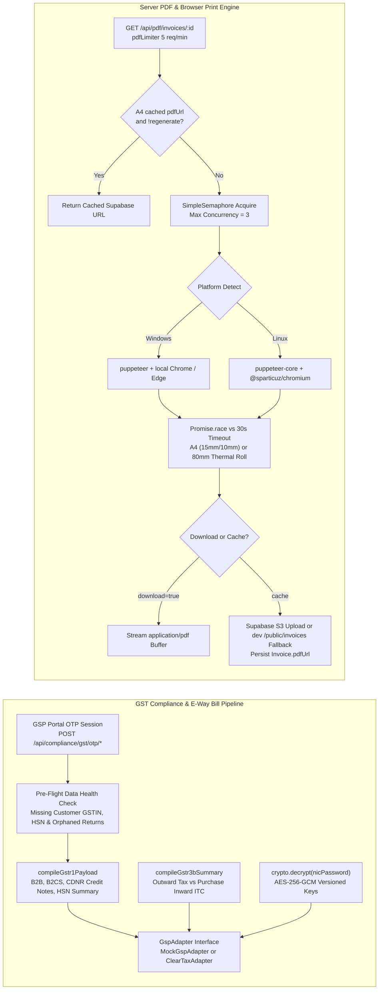
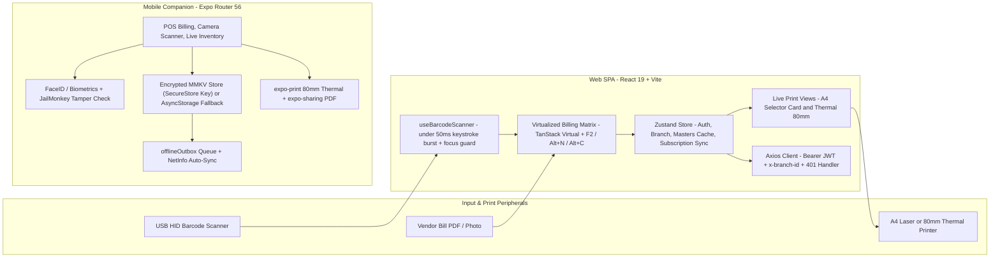

# Groww You ERP — Enterprise Billing, Accounting, GST, CRM & AI Platform

**Groww You ERP** is a multi-tenant, branch-isolated enterprise resource planning, point-of-sale billing, double-entry accounting, GST compliance, B2B CRM, and AI analytics platform engineered as a 3-tier monorepo:

- **Web Client (`/client`)**: React 19 + Vite + Tailwind CSS 4 SPA built on the **Atelier Ledger** design system, featuring a virtualized high-density billing matrix, hardware USB HID barcode capture, live A4 and 80mm thermal print views, and keyboard-first operations (`F2`, `Alt+N`, `Alt+C`, `Ctrl+P`).
- **Backend API (`/server`)**: Node.js + Express 5 + Prisma ORM + PostgreSQL backend featuring automatic `AsyncLocalStorage` multi-tenant & branch Row-Level Security (RLS), concurrency-safe self-healing document sequences, server-side Puppeteer PDF rendering with Supabase S3 caching, Razorpay subscription lifecycle billing, pluggable ClearTax/Mock GSP compliance adapters, and live Google Gemini AI structured-JSON pipelines.
- **Mobile Companion (`/mobile`)**: React Native 0.85 + Expo Router 56 app (iOS, Android, Expo Web) with encrypted MMKV persistence, an offline billing outbox queue with automatic synchronization, camera/POS scanning, biometric & tamper checks, and 80mm thermal receipt printing.

---

## Table of Contents

1. [System & Integration Architecture](#1-system--integration-architecture)
2. [Multi-Tenancy & Branch Row-Level Security (RLS)](#2-multi-tenancy--branch-row-level-security-rls)
3. [Database Schema & Entity Relationships](#3-database-schema--entity-relationships)
4. [Core Operational Flows](#4-core-operational-flows)
   - [Atomic Sales Billing & Double-Entry Ledger Flow](#41-atomic-sales-billing--double-entry-ledger-flow)
   - [Live Gemini AI Pipelines & Multimodal OCR Flow](#42-live-gemini-ai-pipelines--multimodal-ocr-flow)
   - [SaaS Subscription State Machine & Quota Enforcement](#43-saas-subscription-state-machine--quota-enforcement)
   - [GST Compliance Compiler & PDF Rendering Pipeline](#44-gst-compliance-compiler--pdf-rendering-pipeline)
5. [Frontend Architecture & Design System (`client/`)](#5-frontend-architecture--design-system-client)
6. [Mobile Companion Architecture (`mobile/`)](#6-mobile-companion-architecture-mobile)
7. [Security Architecture & Cryptographic Key Rotation](#7-security-architecture--cryptographic-key-rotation)
8. [Repository Structure](#8-repository-structure)
9. [API Route Map](#9-api-route-map)
10. [Environment Configuration & Local Setup](#10-environment-configuration--local-setup)
11. [Verification & Regression Suites](#11-verification--regression-suites)

---

## 1. System & Integration Architecture



---

## 2. Multi-Tenancy & Branch Row-Level Security (RLS)

Every company (`Company`) operates isolated tenant data across one or more operating locations (`Branch`). Instead of duplicating tenant filter predicates manually in every controller query, request context is bound to Node's `AsyncLocalStorage` (`server/utils/context.js`) in `server/middleware/authMiddleware.js` and enforced inside the global Prisma client extension (`server/utils/prisma.js`).



### Tenant vs. Branch Scoping Matrix (`server/utils/prisma.js`)

| Scope Level | Models Enforced | Enforcement Behavior |
| :--- | :--- | :--- |
| **Company (`companyId`)** | `Customer`, `Vendor`, `Item`, `Invoice`, `StockMovement`, `FinancialTransaction`, `Voucher`, `Return`, `Notification`, `Branch` | Always injected on reads, writes, and creates; rejects cross-tenant creates with `Tenant Mismatch`. |
| **Branch (`branchId`)** | `Invoice`, `StockMovement`, `FinancialTransaction`, `Voucher`, `Return`, `BranchStock` | `STAFF` queries without `branchId` throw `403 Access Denied`; admins scope by active `x-branch-id` or consolidated view when unset. |
| **Master Inventory Stock** | `BranchStock` (unique `(branchId, itemId)`) | Product catalog (`Item`) is shared per `Company`, while live stock quantities are tracked per `Branch` inside `BranchStock`. |

---

## 3. Database Schema & Entity Relationships

All operational, accounting, CRM, compliance, and billing records are modeled in `server/prisma/schema.prisma` with composite unique constraints and reporting indexes (`[companyId, invoiceDate]`, `[companyId, invoiceType, invoiceDate]`, `[companyId, createdAt]`, `[companyId, stage]`).



---

## 4. Core Operational Flows

### 4.1 Atomic Sales Billing & Double-Entry Ledger Flow

Every invoice, purchase bill, return, and accounting voucher runs inside `prisma.$transaction(...)` with **zero-trust backend math** (the server ignores client-supplied unit prices/GST totals and recomputes them from persisted `Item` rates) and **self-healing sequence numbering** (`server/utils/sequence.js`).



**Voucher & Double-Entry Support:**
- `Payment`, `Receipt`, `Contra`, and `Journal` vouchers (`server/controllers/vouchersController.js`) enforce cancellation rules (`isCancelled`), update party `outstandingBalance` atomically, and post `FinancialTransaction` ledger lines tied by `voucherId` (`onDelete: Restrict`).
- `PurchaseInvoice` and `SalesReturn` increment `BranchStock` + record `StockMovement("IN")`, while `PurchaseReturn` decrements stock (`"OUT"`).

---

### 4.2 Live Gemini AI Pipelines & Multimodal OCR Flow

Groww You ERP runs three **live** Google Gemini AI integrations (`server/utils/geminiService.js`) with strict `SchemaType` structured JSON outputs, active model fallback iteration (`DEFAULT_GEMINI_MODELS` prioritized flash/lite models), explicit error classification (`GeminiServiceError` returning HTTP `422`/`502`/`503`), and **zero mock or fake fallback text**.



**Cache Invalidation & Grounding Design:**
- Pipeline insights cache (`server/utils/cacheService.js`) is actively invalidated across the tenant whenever sales/purchase invoices, returns, vouchers, or CRM leads change, plus automatic cleanup every 5 minutes.
- CRM lead intelligence uses **write-time caching** directly on PostgreSQL `Lead` columns so opening the drawer renders instantaneously without redundant Gemini calls until the rep clicks refresh.
- OCR normalizes extracted invoice dates (`normalizeInvoiceDate`), strips invalid invoice-number tokens (`"invoice"`, `"subtotal"`, etc.), and performs exact GSTIN/SKU lookup before adaptive `Fuse.js` fuzzy matching.

---

### 4.3 SaaS Subscription State Machine & Quota Enforcement

Tenants progress through trial, paid billing, dunning grace, and locked states managed by `server/middleware/checkSubscription.js`, `server/controllers/billingController.js`, and `server/prisma/seed-billing.js`.



| Middleware Guard | Protected Resources | Plan Parameters Checked |
| :--- | :--- | :--- |
| `checkSubscription` | `/api/transactions/*` writes, `/api/compliance/*` | `TRIAL`/`ACTIVE` validity, 3-day `PAST_DUE` grace window, caches lookup per company for `60s`. |
| `limitInvoiceCount` | `POST /api/transactions/sales-invoices`, `purchase-invoices` | Monthly invoice count vs `plan.features.maxInvoicesPerMonth` (`100` Trial, `1000` Basic Monthly, `12000` Basic Yearly, Unlimited Pro). |
| `limitBranchCount` | Branch provisioning middleware | Total company branches vs `plan.branchLimit` (`1` Trial, `2` Basic, `5` Professional). |
| `requireFeature(...)` | `/api/compliance/gst/*` (`gstFiling`), `/api/compliance/ewaybill/*` (`ewayBill`) | Blocks Starter/Basic tenants with HTTP `403 FEATURE_RESTRICTED` unless `Professional` tier is active. |

**Idempotent Payment Verification:**
- Client checkout (`POST /api/billing/verify-payment`) validates `HMAC-SHA256(razorpay_order_id + "|" + razorpay_payment_id)` with `RAZORPAY_KEY_SECRET`.
- Server webhooks (`POST /api/billing/webhooks`) verify `x-razorpay-signature` on raw JSON buffers and deduplicate delivery events against `WebhookEvent` (`id` primary key).

---

### 4.4 GST Compliance Compiler & PDF Rendering Pipeline



- **A4 vs. Thermal Live Browser Printing (`client/src/pages/print/`):** Dedicated stripped-chrome SPA print routes (`/print/sales-invoice`, `/print/purchase-invoice`, `/print/payment-voucher`, `/print/receipt-voucher`, `/print/thermal-invoice/:id`) load live records with explicit IDs or render `PrintSelectorCard` pagination when opened without an ID (never silently printing an unintended invoice).
- **Orphaned Return Resolver:** Resolves legacy returns (`isWrittenOff`, `legacyInvoiceNo`, `legacyInvoiceDate`) so valid GSTR-1 Credit Notes (`CDNR`) are accurately included or excluded.

---

## 5. Frontend Architecture & Design System (`client/`)

The web client implements the **Atelier Ledger** design system (documented in `.interface-design/system.md` and `docs/ui-ux/`):



| Layer | Implementation Details |
| :--- | :--- |
| **Visual Tokens (`client/src/index.css`)** | Warm paper canvas (`#F5F3EE` light / Deep Obsidian `#131614` dark), Forest Trust primary (`#2D5A47`), Copper accent (`#9F623B`), inset `--input-bg` control surfaces, `IBM Plex Sans` + `IBM Plex Mono` typography with `tabular-nums`, zero banned `transition-all`. |
| **Shared UI Primitives** | `CommonCard`, `CommonTable`, `TableWrapper`, `CommonModal`, `ConfirmDialog`, `Autocomplete` (portal listbox with `focusin` auto-dismiss), `Pagination`, `StatusBadge`, `ValidationMessage`, `EmptyState`, `Skeleton`, `BrandLogo` (theme-aware logo). |
| **Global State (`client/src/store/useStore.js`)** | Zustand store holding JWT `token`, `user`, `branches`, `activeBranchId`, cached `customers`/`vendors`/`items`/`leads`/`company`/`notifications`, `verifyStatus` subscription polling on window focus, and logout sync via `client/src/utils/api.js`. |
| **High-Density Billing UX** | `@tanstack/react-virtual` row virtualization in billing grids; global hotkeys (`F2` save, `Alt+N` add item row, `Alt+C` focus customer/vendor selector, `Ctrl+P` print); `useBarcodeScanner` captures `< 50ms` inter-keystroke scanner bursts ending in `Enter` or 50ms idle while ignoring active form inputs. |
| **Indian Locale Formatting (`client/src/utils/formatters.js`)** | `formatINR`, `formatDashboardINR`, `formatCompactINR`, `formatCount`, and `formatStageLabel` ensure uniform Indian numbering (`₹ 1,80,000.00`) across tables, KPI cards, ledgers, and compliance views without mutating underlying numeric payloads. |

---

## 6. Mobile Companion Architecture (`mobile/`)

| Subsystem | Implementation (`mobile/src/`) |
| :--- | :--- |
| **Navigation (`app/(app)/_layout.tsx`)** | Expo Router 56 bottom tabs: **Dashboard**, **Billing**, **Invoices**, **Inventory**, **Scanner** (Expo Camera POS barcode scanning), and **Profile**, plus `(auth)/login` and `(auth)/onboarding`. |
| **Storage & Security (`store/useStore.ts`, `utils/security.ts`)** | Uses `react-native-mmkv` encrypted via a key stored in `expo-secure-store` (with automatic `AsyncStorage` fallback on Expo Go & Web), `expo-local-authentication` (FaceID/Biometrics), and `JailMonkey` compromised-device / mock-location detection on physical devices. |
| **Offline Billing Outbox** | Queues billing transactions into `offlineOutbox` when offline (`@react-native-community/netinfo`) and reconciles via `syncOfflineOutbox()` once connectivity returns. |
| **Mobile Receipt Printing (`utils/receiptPrinter.ts`)** | Generates 80mm thermal roll HTML receipts via `expo-print` and shares PDFs with `expo-sharing`. |

---

## 7. Security Architecture & Cryptographic Key Rotation

- **Column-Level Envelope Encryption (`server/utils/crypto.js`):** Encrypts sensitive third-party credentials (such as NIC GSP passwords on `Company` and `Branch`) using **AES-256-GCM** formatted as `version:ivHex:tagHex:cipherHex` (e.g., `v1:...`, `v2:...`), with automatic backward compatibility for legacy 3-part unversioned payloads.
- **Zero-Downtime Key Rotation (`server/scripts/rotate-keys.js`):** Batches 500 records at a time to re-encrypt credentials from older `ENCRYPTION_KEY_V*` keys to the active `ACTIVE_ENCRYPTION_KEY_VERSION`.
- **GSP Log Sanitization (`server/utils/cleartaxAdapter.js`):** Response interceptors strip sensitive headers (`nic-system-password`, `Authorization`, `x-cleartax-product-token`, `x-cleartax-auth-token`) from Axios error telemetry.
- **API Abuse & Input Hardening:** `express-rate-limit` guards PDF rendering (`5 req/min`), reports (`20 req/min`), and AI analytics (`30 req/min`); Zod schemas enforce Indian GSTIN (`15`-char pattern), 10-digit mobile, 6-digit pincode, GST slabs (`0, 5, 12, 18, 28`), and email formats.

---

## 8. Repository Structure

```text
Groww_You_ERP/
├── .github/workflows/ci.yml        # GitHub Actions CI for mobile (TypeScript + ESLint on main/mobile/**)
├── .interface-design/system.md     # Atelier Ledger design system specification
├── docs/ui-ux/                     # Audit, benchmark analysis, and 95 before/after UI verification PNGs
├── client/                         # Web Frontend (React 19 + Vite + Tailwind CSS 4)
│   ├── index.html                  # App shell, Google Fonts (IBM Plex Sans/Mono), favicon & theme bootstrap
│   ├── public/                     # Static favicon & brand logos (groww_you_erp_logo_icon.png, etc.)
│   └── src/
│       ├── components/             # Common primitives, Navbar, Sidebar, Breadcrumb, LeadDetailDrawer,
│       │                           # AIPipelineInsightsCard, InvoiceOcrUpload, print headers/signatures
│       ├── hooks/                  # useBarcodeScanner.js, useDebounce.js
│       ├── pages/                  # Dashboard, Login, ReportsDashboard, masters/, sales/, purchase/,
│       │                           # accounts/, books/, crm/, reports/, settings/, print/
│       ├── store/useStore.js       # Global Zustand state (auth, branch, masters cache, subscription sync)
│       └── utils/                  # api.js (JWT + x-branch-id interceptors), formatters.js
├── server/                         # Backend API (Node.js + Express 5 + Prisma ORM)
│   ├── index.js                    # Express app mount, CORS, raw webhook parser, graceful Chromium shutdown
│   ├── controllers/                # 17 modular domain controllers (analytics, auth, billing, branch, etc.)
│   ├── middleware/                 # authMiddleware.js, checkSubscription.js, validateMiddleware.js
│   ├── prisma/                     # schema.prisma, migrations/, seed.js, seed-billing.js, backfill scripts
│   ├── routes/                     # 17 Express route modules
│   ├── scripts/rotate-keys.js      # Zero-downtime AES-256-GCM key rotation utility
│   ├── scratch/                    # Standalone functional, isolation, AI, OCR & compliance test suites
│   └── utils/                      # prisma.js (RLS), geminiService.js, pdfService.js, gstService.js,
│                                   # cleartaxAdapter.js, mockGspAdapter.js, s3Service.js, sequence.js,
│                                   # crypto.js, cacheService.js, pagination.js, context.js, loadEnv.js
└── mobile/                         # Mobile POS Companion (React Native 0.85 + Expo Router 56)
    ├── app.json                    # Expo app config, deep links, adaptive icons, FaceID permissions
    └── src/
        ├── app/                    # (auth)/login,onboarding and (app)/dashboard,billing,invoices,inventory,scanner,profile
        ├── components/             # ScreenLayout, UI kit, offline banner, scan overlay, animated splash
        ├── constants/              # Dark-mode POS color/typography/spacing/animation tokens
        ├── store/useStore.ts       # MMKV-persisted Zustand store + offlineOutbox sync engine
        └── utils/                  # api.ts, receiptPrinter.ts, pdfShare.ts, security.ts, secureStoreWrapper.ts
```

---

## 9. API Route Map

All authenticated routes accept `Authorization: Bearer <token>` and optional `x-branch-id` (for `SUPER_ADMIN` / `COMPANY_ADMIN`).

| Mount Path (`server/index.js`) | Key Endpoints | Middleware & Features |
| :--- | :--- | :--- |
| `/api/auth` | `POST /login`, `POST /forgot-password`, `GET /verify-status`, `GET /status` | Zod verification on password reset (`GSTIN` or `Mobile`), JWT issuance (`companyId`, `branchId`, `role`, `subscription`). |
| `/api/masters` | CRUD `/customers`, `/vendors`, `/items` | `verifyTokenAndTenant`, Zod validation (`customerSchema`, `vendorSchema`, `itemSchema`). |
| `/api/branches` | `GET /`, `GET /:id`, `PUT /:id` | Tenant-isolated branch listing and branch settings updates. |
| `/api/transactions` | `GET/POST /sales-invoices`, `GET /sales-invoices/:id`, `GET/POST /purchase-invoices`, `GET /purchase-invoices/:id`, `GET/POST /sales-returns`, `GET/POST /purchase-returns`, `GET/POST /vouchers`, `POST /vouchers/:id/cancel` | `verifyTokenAndTenant`, `checkSubscription`, `limitInvoiceCount` on invoice creation, atomic DB transactions + sequences. |
| `/api/reports` | `GET /sales`, `/purchase`, `/stock`, `/outstanding`, `/ledger`, `/cash-book`, `/bank-book`, `/day-book`, `/summary` | `verifyTokenAndTenant`, `reportsLimiter` (`20 req/min`), 30-day default bounded date windows. |
| `/api/analytics` | `GET /sales-insights`, `POST /sales-insights/feedback` | `verifyTokenAndTenant`, `analyticsLimiter` (`30 req/min`), live Gemini insights + 1h TTL branch cache. |
| `/api/leads` | `GET /`, `GET /:id`, `POST /`, `PUT /:id`, `POST /:id/interactions`, `PUT /:id/ai-analyze`, `DELETE /:id` | `verifyTokenAndTenant`, write-time cached Gemini CRM Risk Profiler + cache invalidation. |
| `/api/invoices/ocr` | `POST /` (`multipart/form-data` field `file`) | `verifyTokenAndTenant`, Multer `5 MB` memory upload (`PDF/PNG/JPG/WEBP`), `pdf-lib` 3-page guard, Gemini Vision OCR + S3 backup + `Fuse.js` mapping. |
| `/api/compliance` | `GET /gst/health`, `POST /gst/otp/request`, `POST /gst/otp/verify`, `GET /gst/gstr1/preview`, `POST /gst/gstr1/file`, `GET /gst/gstr3b/summary`, `GET /gst/session-status`, `POST /ewaybill/generate/:invoiceId`, `GET /orphans`, `POST /orphans/resolve` | `verifyTokenAndTenant`, `checkSubscription`, `requireFeature('gstFiling' \| 'ewayBill')` on GST/E-Way routes. |
| `/api/pdf` | `GET /invoices/:id` (`?layout=Thermal&download=true&regenerate=true`) | `verifyTokenAndTenant`, `pdfLimiter` (`5 req/min`), Puppeteer pooled PDF rendering + S3 cache. |
| `/api/billing` | `POST /webhooks` *(raw body)*, `GET /plans`, `POST /checkout`, `POST /verify-payment`, `GET /history` | Public plans & HMAC webhook verification (`WebhookEvent` idempotency); authenticated checkout & upgrade verification. |
| `/api/razorpay` | `POST /create-order`, `POST /verify-payment` | Sandbox Razorpay order testing endpoints. |
| `/api/company`, `/api/users`, `/api/notifications`, `/api/search` | Company settings, RBAC staff user CRUD, notifications, global search | `requireRole(["SUPER_ADMIN", "COMPANY_ADMIN"])` on user admin routes. |

---

## 10. Environment Configuration & Local Setup

### Prerequisites
- **Node.js** `v18+` (verified on `v22.14.0` / npm `11.5.2`)
- **PostgreSQL** instance
- *(Optional)* Google Gemini API key, Razorpay keys, Supabase S3 bucket, ClearTax sandbox credentials

### A. Backend Setup (`/server`)

1. Install dependencies:
   ```bash
   cd server
   npm install
   ```
2. Configure `server/.env`:
   ```env
   # Server & Database
   PORT=5000
   NODE_ENV=development
   FRONTEND_URL="http://localhost:5173"
   DATABASE_URL="postgresql://<user>:<password>@<host>:<port>/<db_name>?schema=public"
   JWT_SECRET="your_jwt_secret"

   # Column Encryption (AES-256-GCM Versioned Rotation)
   ENCRYPTION_KEY="legacy_encryption_key_32_bytes_or_hex"
   ENCRYPTION_KEY_V1="version_1_encryption_key"
   ENCRYPTION_KEY_V2="version_2_encryption_key"
   ACTIVE_ENCRYPTION_KEY_VERSION="v1"

   # Google Gemini AI (Analytics, CRM Profiler, Invoice OCR)
   GEMINI_API_KEY="your_gemini_api_key"
   # GEMINI_MODEL="gemini-3.1-flash-lite"

   # Supabase S3 Storage (A4 PDFs & OCR Scanned Invoices)
   SUPABASE_S3_ENDPOINT="https://<project-ref>.supabase.co/storage/v1/s3"
   SUPABASE_S3_REGION="ap-southeast-1"
   SUPABASE_S3_ACCESS_KEY="your_access_key"
   SUPABASE_S3_SECRET_KEY="your_secret_key"
   SUPABASE_S3_BUCKET="invoices"

   # GSP Compliance Provider ("mock" or "cleartax")
   GSP_PROVIDER="mock"
   GSP_BASE_URL="https://api-sandbox.cleartax.in"
   GSP_CLIENT_ID="your_gsp_client_id"
   GSP_CLIENT_SECRET="your_gsp_client_secret"
   GSP_AUTH_TOKEN="your_cleartax_product_token"

   # Razorpay SaaS Billing
   RAZORPAY_KEY_ID="rzp_test_..."
   RAZORPAY_KEY_SECRET="your_razorpay_secret"
   RAZORPAY_WEBHOOK_SECRET="your_webhook_secret"

   # Optional Windows Browser Path for Puppeteer
   # PUPPETEER_EXECUTABLE_PATH="C:\Program Files\Google\Chrome\Application\chrome.exe"
   ```
3. Push schema, generate Prisma Client, and seed plans/demo data:
   ```bash
   npx prisma generate
   npx prisma db push
   node prisma/seed-billing.js
   node prisma/seed.js
   ```
4. Start the API server:
   ```bash
   npm run dev
   ```

### B. Web Frontend Setup (`/client`)

1. Install dependencies & configure `client/.env`:
   ```bash
   cd client
   npm install
   ```
   `client/.env`:
   ```env
   VITE_API_URL="http://localhost:5000/api"
   ```
2. Start Vite dev server (`http://localhost:5173`):
   ```bash
   npm run dev
   ```

### C. Mobile Companion Setup (`/mobile`)

```bash
cd mobile
npm install
# Copy mobile/.env.example -> mobile/.env and set EXPO_PUBLIC_API_URL
npx expo start
```

---

## 11. Verification & Regression Suites

### Web Client Checks
```bash
cd client
npm run lint
npm run build
```

### Mobile Client Checks (also enforced by `.github/workflows/ci.yml` on `main`)
```bash
cd mobile
npx tsc --noEmit
npx eslint . --max-warnings=0
```

### Backend Functional, Isolation, Compliance & AI Suites (`server/scratch/`)
```bash
cd server
node scratch/test-branch-isolation.js
node scratch/test-compliance.js
node scratch/test-ai-failure-branch-regression.js
node scratch/test-analytics-insights.js
node scratch/test-ocr-invoice-scanner.js
node scratch/test-lead-ai-profiler.js
node scratch/test-concurrency-billing.js
node scratch/test-self-healing-sequence.js
node scratch/test-subscription-billing.js
node scratch/test-crypto.js
```

### Key Rotation Utility
To re-encrypt existing credentials in `Company` / `Branch` rows to `ACTIVE_ENCRYPTION_KEY_VERSION`:
```bash
cd server
node scripts/rotate-keys.js
```
